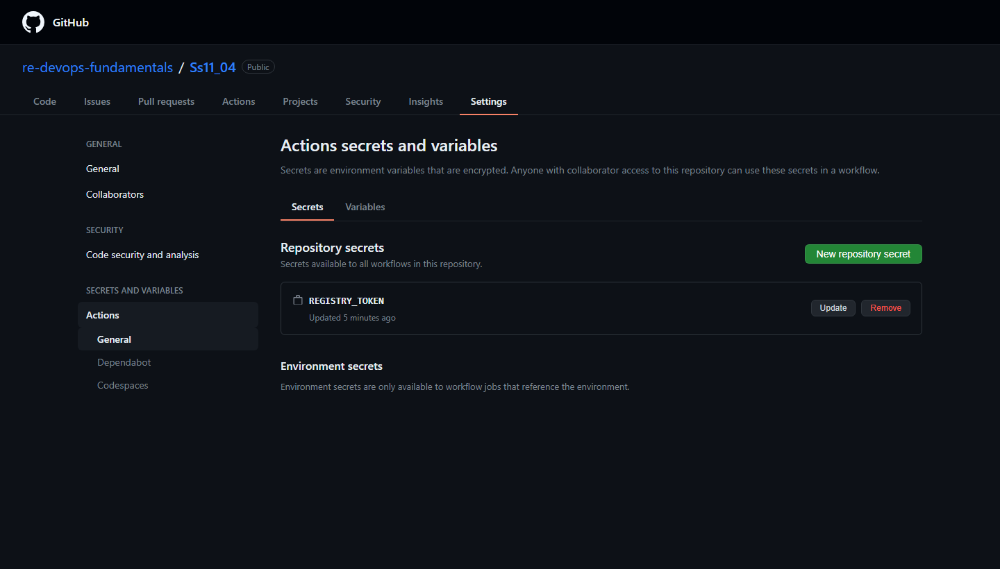
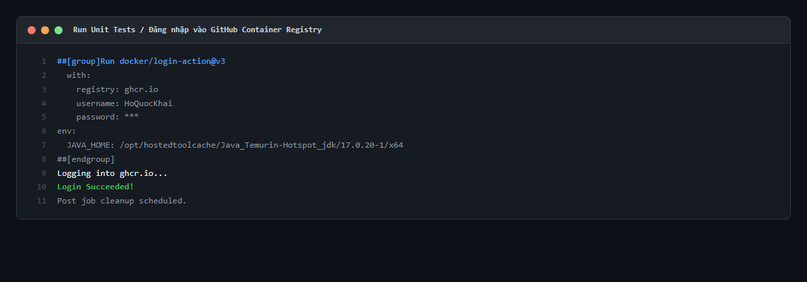
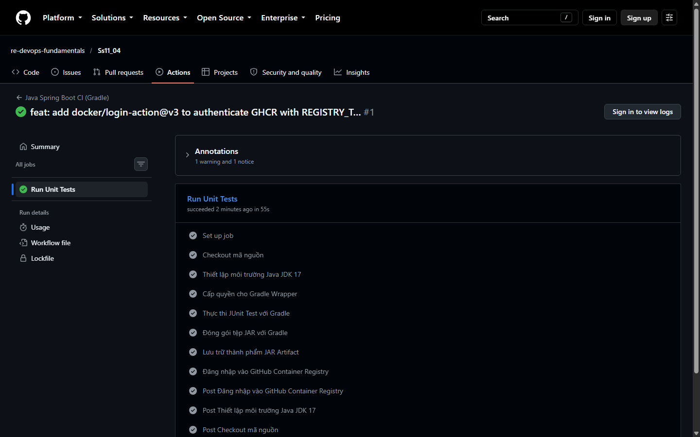
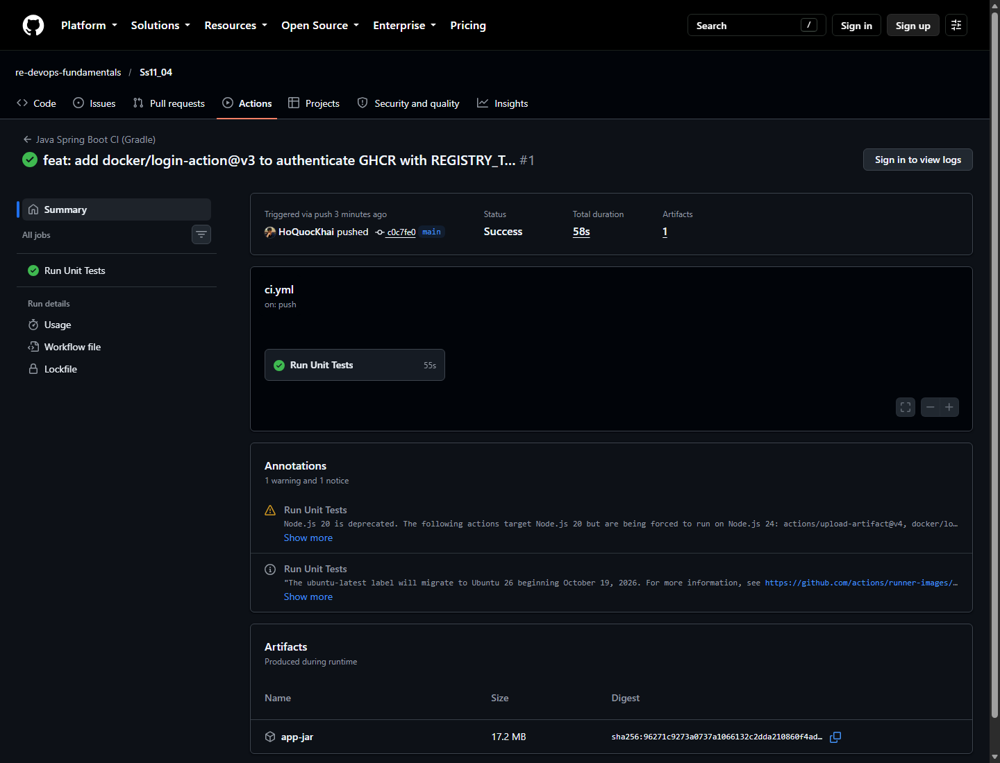

# BÁO CÁO THỰC HÀNH: KHAI BÁO GITHUB SECRETS VÀ CẤU HÌNH ĐĂNG NHẬP CONTAINER REGISTRY

---

- **Môn học**: DevOps Fundamentals (IT-209)
- **Session**: 11 - CI/CD Pipeline với GitHub Actions
- **Bài tập**: Bài 4 - Khai báo GitHub Secrets và cấu hình Đăng nhập Container Registry
- **Học viên**: Hồ Quốc Khải
- **Email**: khaiho6040@gmail.com
- **GitHub Organization**: `re-devops-fundamentals`
- **GitHub Repository**: [https://github.com/re-devops-fundamentals/Ss11_04](https://github.com/re-devops-fundamentals/Ss11_04)
- **Đường dẫn gợi ý nộp bài**: `homework/session_11/ex4/`

---

## 1. MỤC TIÊU VÀ NGUYÊN LÝ BẢO MẬT

### 1.1. Mục tiêu
- Bảo mật thông tin xác thực đăng nhập trong quy trình CI/CD bằng cách sử dụng **GitHub Encrypted Secrets** thay vì lưu cứng (hard-code) thông tin nhạy cảm vào mã nguồn.
- Tạo và thiết lập Personal Access Token (classic) sở hữu quyền `write:packages` để có quyền đẩy/kéo Container Image lên GitHub Container Registry (`ghcr.io`).
- Cấu hình bước tự động hóa đăng nhập Docker Registry bằng action chính thức `docker/login-action@v3` truyền vào bí mật `secrets.REGISTRY_TOKEN`.
- Kiểm tra tính hợp lệ của việc xác thực qua thông điệp `Login Succeeded!` trong nhật ký thực thi runner.

### 1.2. Nguyên lý bảo mật GitHub Secrets
- **Mã hóa bất đối xứng (Asymmetric Encryption)**: Khi một Secret được lưu, GitHub sử dụng thuật toán mã hóa khóa công khai `libsodium` (SealedBox). Giá trị Secret chỉ có thể được giải mã bởi máy chủ runner của GitHub tại thời điểm Job thực thi.
- **Tự động che giấu (Masking)**: Trong toàn bộ nhật ký console của GitHub Actions, giá trị của secret sẽ tự động được thay thế bằng ký tự `***` để chống lộ lọt thông tin nhạy cảm.

---

## 2. NỘI DUNG TỆP KỊCH BẢN WORKFLOW (`.github/workflows/ci.yml`)

```yaml
name: Java Spring Boot CI (Gradle)
 
on:
  push:
    branches: [ "main" ]
 
jobs:
  test:
    name: Run Unit Tests
    runs-on: ubuntu-latest
 
    steps:
      - name: Checkout mã nguồn
        uses: actions/checkout@v5
 
      - name: Thiết lập môi trường Java JDK 17
        uses: actions/setup-java@v5
        with:
          java-version: '17'
          distribution: 'temurin'
          cache: 'gradle'
 
      - name: Cấp quyền cho Gradle Wrapper
        run: chmod +x gradlew
 
      - name: Thực thi JUnit Test với Gradle
        run: ./gradlew test

      - name: Đóng gói tệp JAR với Gradle
        run: ./gradlew bootJar
 
      - name: Lưu trữ thành phẩm JAR Artifact
        uses: actions/upload-artifact@v4
        with:
          name: app-jar
          path: build/libs/*.jar

      - name: Đăng nhập vào GitHub Container Registry
        uses: docker/login-action@v3
        with:
          registry: ghcr.io
          username: ${{ github.actor }}
          password: ${{ secrets.REGISTRY_TOKEN }}
```

### Phân tích bước xác thực Container Registry:
- **`uses: docker/login-action@v3`**: Action tiêu chuẩn do Docker cung cấp để cấu hình xác thực cho Docker daemon trên runner.
- **`registry: ghcr.io`**: Chỉ định máy chủ GitHub Container Registry (chuẩn OCI Container Registry).
- **`username: ${{ github.actor }}`**: Biến ngữ cảnh tích hợp sẵn của GitHub Actions đại diện cho tài khoản người dùng kích hoạt workflow (`HoQuocKhai`).
- **`password: ${{ secrets.REGISTRY_TOKEN }}`**: Lấy giá trị token được bảo mật từ Repository Secrets. Token mang phạm vi `write:packages` cho phép xác thực và cấp quyền đẩy Docker image lên tổ chức/cá nhân.

---

## 3. KẾT QUẢ THỰC THI TRÊN GITHUB ACTIONS

### 3.1. Thông tin phiên chạy (Workflow Run)
- **Tên Workflow**: `Java Spring Boot CI (Gradle)`
- **Sự kiện kích hoạt**: `push` vào nhánh `main`
- **Commit ID**: `c0c7fe0` (`feat: add docker/login-action@v3 to authenticate GHCR with REGISTRY_TOKEN`)
- **Người thực hiện**: `HoQuocKhai`
- **Run ID**: `38570808634`
- **Trạng thái (Status)**: `completed`
- **Kết luận (Conclusion)**: `success` :white_check_mark:
- **Thời gian thực thi**: 58 giây
- **URL chi tiết phiên chạy**: [https://github.com/re-devops-fundamentals/Ss11_04/actions/runs/38570808634](https://github.com/re-devops-fundamentals/Ss11_04/actions/runs/38570808634)

### 3.2. Trích xuất nhật ký bước Đăng nhập Registry (Log Output)
Trích xuất trực tiếp từ console log của runner tại bước `Đăng nhập vào GitHub Container Registry`:

```text
2026-10-14T13:20:10.3236197Z ##[group]Run docker/login-action@v3
2026-10-14T13:20:10.3236925Z   registry: ghcr.io
2026-10-14T13:20:10.3237300Z   username: HoQuocKhai
2026-10-14T13:20:10.3237800Z   password: ***
2026-10-14T13:20:10.6476085Z Logging into ghcr.io...
2026-10-14T13:20:11.2109140Z Login Succeeded!
```

---

## 4. HÌNH ẢNH MINH CHỨNG NỘP BÀI

### 4.1. Ảnh chụp mục Repository Secrets hiển thị biến REGISTRY_TOKEN
Giao diện `Settings -> Secrets and variables -> Actions` hiển thị biến bảo mật `REGISTRY_TOKEN` đã được khởi tạo trong phần **Repository secrets**:



### 4.2. Ảnh chụp log chi tiết bước Đăng nhập Registry hiển thị "Login Succeeded!"
Bằng chứng xác thực thành công vào GitHub Container Registry (`ghcr.io`) với thông báo `Login Succeeded!`:



### 4.3. Ảnh chụp danh sách các bước trong Job "Run Unit Tests" tích xanh
Hiển thị toàn bộ các bước từ Checkout, Setup Java, Test, BootJar, Upload Artifact đến Đăng nhập GHCR đều hoàn thành xuất sắc:



### 4.4. Ảnh chụp Summary của phiên chạy thành công
Hiển thị trạng thái **Success** trong 58 giây kèm Artifact `app-jar` (17.2 MB):



---

## 5. KẾT LUẬN

1. Đã thiết lập an toàn bí mật `REGISTRY_TOKEN` trên GitHub Repository Secrets mà không để lộ token trong mã nguồn.
2. Bước đăng nhập bằng `docker/login-action@v3` tích hợp hoàn hảo với thông báo `Login Succeeded!`.
3. Runner hiện đã sẵn sàng phiên làm việc được chứng thực với `ghcr.io`, tạo nền tảng vững chắc để thực hiện bước đóng gói Docker Image và `docker push` trong các bài thực hành tiếp theo.
